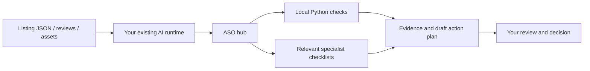

# Claude ASO

Open-source app store optimization inside the AI agent you already use.

[](https://github.com/BipinBudhathoki01/claude-aso/actions/workflows/ci.yml)
[](LICENSE)
[](https://github.com/BipinBudhathoki01/claude-aso/releases)

[Quick start](#quick-start) · [Agents](#meet-the-agents) · [Commands](#commands) · [Examples](#see-the-output) · [FAQ](#faq) · [Contribute](#contribute)

Audit Google Play and Apple App Store listings, find wasted keyword space, review stability metrics, organize user feedback, and prepare a measurable improvement plan.

**14 specialist agents / 16 specialist skills + 1 hub / 18 command intents / 9 Python helpers**

Claude Code uses your configured Claude model. Codex uses your configured model. Other compatible agents can read the same skill files. No mandatory model API key, Gemini dependency, web app, or hosted service. Your host runtime's normal billing, permissions, and data handling apply.

## What it does

- **Listing checks:** supplied character budgets, keyword redundancy, release copy, and store-specific recommendations.
- **Reviews:** model-assisted issue clustering and reply drafts, plus local CSV rating/version summaries.
- **Discovery:** competitor lookup, keyword-position evidence, actionable gap analysis, localization, and optional AI citation-readiness checklists.
- **Conversion:** screenshot briefs, monetization feedback, and experiment plans with explicit assumptions.
- **Policy and quality:** source-backed claim review and checks against supplied Android vitals.
- **Reports:** reproducible Markdown/JSON metadata reports and before/after listing comparisons.

This is an early community release. The helpers are tested; model judgment and runtime behavior need real-world validation. Recommendations require human review. No ranking gains, store approval, or AI citations are guaranteed.

## Quick start

### Claude Code plugin

Run inside Claude Code:

```text
/plugin marketplace add BipinBudhathoki01/claude-aso
/plugin install app-store-aso@claude-aso-marketplace
```

Then ask the plugin hub:

```text
/app-store-aso:aso audit /absolute/path/to/listing.json
```

The plugin ID is `app-store-aso`; the repository is `claude-aso`. This avoids Claude's reserved third-party plugin-name prefix.

### Codex

Clone the pack:

```sh
git clone https://github.com/BipinBudhathoki01/claude-aso.git
cd claude-aso
```

Install on macOS/Linux:

```sh
bash install.sh codex
```

Or Windows PowerShell:

```powershell
./install.ps1 -Runtime codex
```

Restart Codex, invoke `$claude-aso`, and ask it to audit your listing file. The full pack installs to `~/.codex/skills/claude-aso`, respecting `CODEX_HOME` when set. It inherits the model configured in Codex.

### Claude Code manual installation

From the cloned repository, run `bash install.sh claude` or `./install.ps1 -Runtime claude`, restart Claude Code, and use `/aso`. The complete pack installs to `~/.claude/skills/aso`.

### Cursor and other agents

Open the cloned directory in your agent and ask it to read `SKILL.md`. Keep the complete pack together. Native discovery, slash commands, and delegation vary by runtime; equivalent plain-language requests work without those features.

Both installers refuse to overwrite an existing destination. Back up custom changes before deliberately replacing an installation. See [troubleshooting](docs/TROUBLESHOOTING.md).

## Meet the agents

These are specialist instruction files, not 14 separately hosted models. The host controls model choice, tool access, and concurrency. Only relevant specialists are needed for a task.

| Agent | Role | Command intent |
| --- | --- | --- |
| [`aso-playstore`](agents/aso-playstore.md) | Google Play metadata reviewer | `aso playstore` |
| [`aso-appstore`](agents/aso-appstore.md) | Apple metadata and keywords reviewer | `aso appstore` |
| [`aso-reviews`](agents/aso-reviews.md) | Review themes and reply drafts | `aso reviews` |
| [`aso-keywords`](agents/aso-keywords.md) | Keyword intent strategist | `aso keywords` |
| [`aso-vitals`](agents/aso-vitals.md) | Stability metrics reviewer | `aso vitals` |
| [`aso-geo`](agents/aso-geo.md) | AI discovery readiness reviewer | `aso geo` |
| [`aso-screenshots`](agents/aso-screenshots.md) | Screenshot conversion reviewer | `aso screenshots` |
| [`aso-competitor-lookup`](agents/aso-competitor-lookup.md) | Competitor discovery, ranking evidence, and action plans | `aso competitor-lookup` |
| [`aso-competitor`](agents/aso-competitor.md) | Competitor positioning analyst | `aso competitor` |
| [`aso-localization`](agents/aso-localization.md) | Locale and language strategist | `aso localization` |
| [`aso-monetization`](agents/aso-monetization.md) | Paywall feedback reviewer | `aso monetization` |
| [`aso-policy`](agents/aso-policy.md) | Source-backed store policy reviewer | `aso policy` |
| [`aso-experiments`](agents/aso-experiments.md) | Experiment planner | `aso experiments` |
| [`aso-reporting`](agents/aso-reporting.md) | Metadata reports and revision comparisons | `aso report`, `aso compare` |

The 16 specialist skills add release-note and FLOW workflows alongside these roles. One hub routes requests. A full audit can delegate relevant checks when the runtime supports agents; otherwise it applies the same checklists sequentially. It must report only work actually performed.

## Commands

These are agent request intents. In the Claude plugin, append the intent after `/app-store-aso:aso`; in a manual Claude install, use `/aso`; in Codex invoke `$claude-aso` and ask in plain language. Terminal helpers appear in the next section.

| Intent and input | Output |
| --- | --- |
| `aso audit listing.json` | Prioritized cross-store findings and evidence gaps |
| `aso playstore listing.json` | Play listing recommendations and character counts |
| `aso appstore listing.json` | Apple listing and keyword recommendations |
| `aso reviews reviews.csv` | Rating summary, model-generated themes, reply drafts |
| `aso keywords seed-list` | Intent and placement hypotheses |
| `aso vitals listing.json` | Supplied metric threshold checks |
| `aso geo app-url` | Citation-readiness and structured-data review |
| `aso screenshots asset-directory` | Asset review when image tools are available; otherwise a brief |
| `aso competitor-lookup app-id keyword` | Discover rivals, verify position evidence, and prioritize improvements |
| `aso competitor app-ids` | Evidence-backed comparison; public Apple lookup helpers available |
| `aso localization listing.json` | Locale priorities and localized copy drafts |
| `aso monetization reviews.csv` | Paywall friction and positioning review |
| `aso release-notes listing.json` | Release-note drafts |
| `aso flow listing.json` | Staged optimization plan |
| `aso policy listing.json` | Policy-risk table with sources and confidence |
| `aso experiments listing.json` | Test brief, feasibility, assumptions, and guardrails |
| `aso report listing.json` | Offline Markdown/JSON metadata report |
| `aso compare before.json after.json` | Changed fields, budgets, introduced/resolved findings |

[Full command reference](docs/COMMANDS.md) · [Routing map](data/commands.json)

## See the output

Try the helpers without any AI account. Python 3.10+ is required; no third-party Python packages are needed.

```sh
python scripts/aso_lint.py examples/listing.json
python scripts/audit_report.py examples/listing.json --format markdown
python scripts/audit_report.py examples/listing.json --format json
python scripts/listing_diff.py before.json after.json
python scripts/review_summary.py examples/reviews.csv
```

The included sample produces these real character budgets:

| Field | Used / limit |
| --- | --- |
| Play title | 25 / 30 |
| Play short description | 67 / 80 |
| Apple name | 12 / 30 |
| Apple subtitle | 28 / 30 |
| Apple keywords | 39 / 100 |

[View the generated sample report](examples/audit-report.md) · [Sample listing](examples/listing.json) · [Sample reviews](examples/reviews.csv)

The review CSV sample contains 3 synthetic reviews, with an average rating of 3.667 and one 1–2 star review. The helper aggregates data; theme and sentiment interpretation belongs to the user's model. Reports check supplied fields only, not full submission readiness.

Other helpers:

```sh
python scripts/ab_test_planner.py 28 10 1500 90
python scripts/launch_checklist.py 2026-12-01
python scripts/fetch_appstore.py 324684580 us
python scripts/competitor_gap.py "focus timer"
python scripts/competitor_lookup.py --term "study timer" --country np --target-id 1234567890
```

The final three access Apple's public iTunes APIs. Competitor lookup records source URLs and capture time; API result order is not verified store rank. See [competitor research](docs/COMPETITOR_RESEARCH.md) for position evidence and actionable comparisons. The sample-size calculator is a rough planning estimate, not a significance test. See [data formats](docs/DATA_FORMATS.md) and [store sources](docs/SOURCES.md).

## How it works



[Architecture](docs/ARCHITECTURE.md) · [Changelog](CHANGELOG.md)

## FAQ

**Is it free?** The pack is MIT licensed. Your AI runtime, model subscription, or provider may charge for use. Offline helpers do not call a model.

**Does it choose Claude, Codex, or another model?** Your runtime chooses. The pack does not force a model or add an AI provider dependency.

**Does it connect to my store account?** No. Authenticated Play Console and App Store Connect connectors are future extension ideas. Public Apple lookup is included. No automatic listing publication, review posting, or experiment creation is included.

**Does it collect data?** Local validation and reporting helpers make no network requests. The Apple helpers send supplied IDs or search terms to Apple. The host agent may send your input to its configured model provider. Redact private data before sharing reports.

**Can all agents run at once?** Only if the host supports it, permits it, and has capacity. The pack supports sequential fallback and makes no fixed parallelism or runtime promises.

**What has been tested?** There are 31 automated tests for helpers, invalid inputs, routing, installer behavior, and metadata boundaries. CI covers Windows/Linux with Python 3.10/3.13. Plugin validation also runs locally; real model output quality remains a separate review task.

## Contribute

Help with real-world runtime testing, source-backed policy updates, useful audit examples, localization, or future read-only store connectors.

- [Report a bug or suggest a feature](https://github.com/BipinBudhathoki01/claude-aso/issues)
- [Discuss workflows](https://github.com/BipinBudhathoki01/claude-aso/discussions)
- Read [contribution guidance](CONTRIBUTING.md), [community conduct](CODE_OF_CONDUCT.md), and [security reporting](SECURITY.md).

```sh
python -m unittest discover -s tests -v
```

MIT licensed. Independent project maintained by [Bipin Budhathoki](https://github.com/BipinBudhathoki01) and contributors; not affiliated with Anthropic, OpenAI, Google, or Apple.

For community support use the [issue templates](https://github.com/BipinBudhathoki01/claude-aso/issues/new/choose). Fork the repository to contribute; see [CONTRIBUTING.md](CONTRIBUTING.md).

Upgrading from an earlier release? Back up customized skills and remove the earlier plugin/skill entry before installing Claude ASO, so both command sets are not loaded together. Historical tags retain their original contents.
